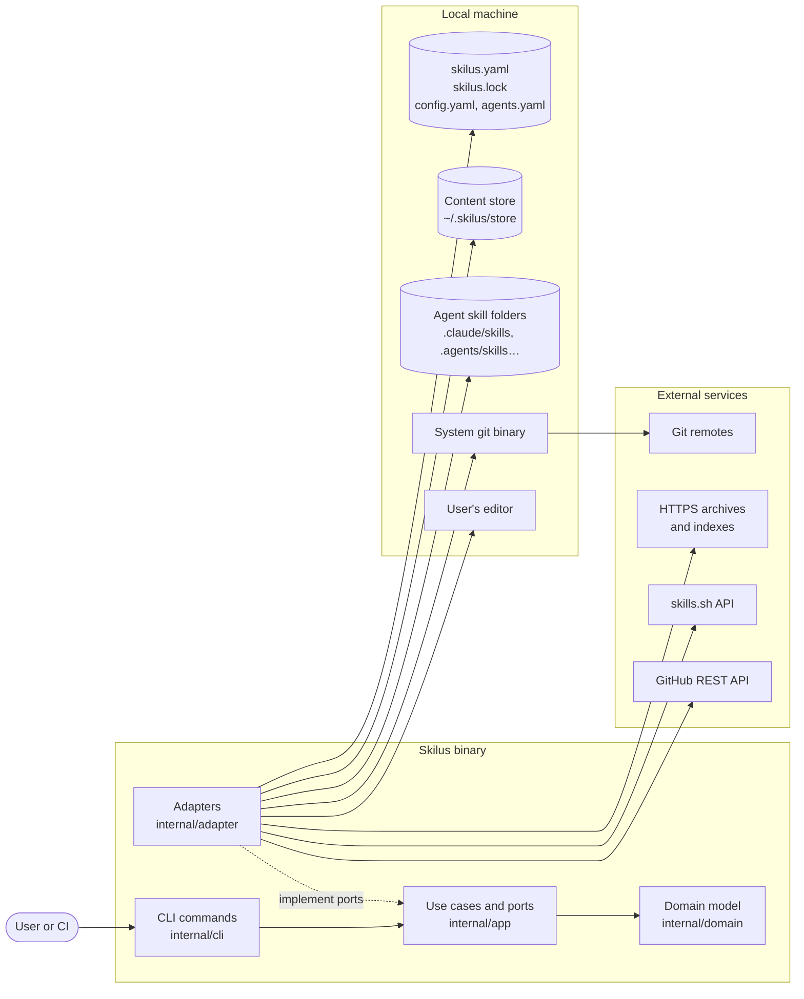

# skilus

_Skilus_ is a command-line manager for AI agent skills (`SKILL.md`), shipped as a single Go binary. It installs skills from Git, ZIP or tar.gz archives or local folders into the agents on your machine, and guarantees that what gets installed is exactly what was reviewed: every skill is pinned to a commit, content-hashed and inspected before install.

> Status: stable since v1.0.0. Releases follow [semantic versioning](https://semver.org).

## Documentation

**Full documentation in 22 languages at [skilus.dev](https://skilus.dev/doc/), with one version per release.**

| Start here | Day to day | Security and teams |
| --- | --- | --- |
| [Overview](https://skilus.dev/doc/en/overview/) | [Adding skills](https://skilus.dev/doc/en/add/) | [Inspection & trust](https://skilus.dev/doc/en/inspect/) |
| [Getting Started](https://skilus.dev/doc/en/getting-started/) | [Updates](https://skilus.dev/doc/en/update/) | [Lockfile & sync](https://skilus.dev/doc/en/lock/) |
| [User Guide](https://skilus.dev/doc/en/user-guide/) | [Search & indexes](https://skilus.dev/doc/en/search/) | [Profiles](https://skilus.dev/doc/en/profiles/) |
| [FAQ](https://skilus.dev/doc/en/faq/) | [The skilus.yaml file](https://skilus.dev/doc/en/manifest/) | [Agents & dependencies](https://skilus.dev/doc/en/agents/) |

## Functional description

A skill is a folder of instructions and scripts that an AI agent (Claude Code, Codex, Cursor, GitHub Copilot, Gemini CLI, Windsurf…) runs with your permissions. _Skilus_ manages them the way a package manager manages dependencies:

- `skilus.yaml` holds the **intent**: which skills you want, their source and ref, profiles, trusted sources (`trust:`) and search indexes (`indexes:`).
- `skilus.lock` holds the **result**: the exact content installed, its commit, its SHA-256 and the agents it went to.
- `~/.skilus/store/<sha256>` is a content store shared by every project.

The main flow is: `skilus add` fetches a skill, inspects it, shows a plan and asks for confirmation; it then stores the content, deploys it to the selected agents and records it in both files. Later, `skilus verify` detects any drift from the lock and `skilus sync` rebuilds the same setup on another machine, like `npm ci`.

_Skilus_ works in two scopes:

- **Project** (default): files in the folder where you run skilus; skills are copied into each agent's project folder (for example `.claude/skills`) so they can be committed and shared with your team.
- **Global** (`--scope global`): files in `~/.skilus/`; skills go into each agent's user folder (for example `~/.claude/skills`) as symlinks to the store, or copies on Windows.

There is no authentication of its own and no server: Git sources use the system `git` binary and your existing credentials, and _Skilus_ never stores tokens or passwords.

## Main features

- **Install from many sources:** GitHub shorthand (`owner/repo`), any Git URL (https, ssh, `file://`, `git@host:`), optional `@ref` (tag, branch or commit; default branch otherwise), ZIP or tar.gz archives over https, and local folders.
- **Pre-install inspection:** blocks symlinks that escape the skill, oversized files and control characters; warns about executables, `curl … | sh`, credential access and invisible text. `--strict` turns warnings into rejections and executables need `--allow-scripts` with `--yes`.
- **Integrity:** `skilus verify` re-hashes every installed skill and reports drift (exit code 6); `skilus sync` restores the locked state.
- **Updates:** `skilus update --check` finds branches or tags that moved; `skilus update` shows the diff and re-inspects before applying. It also applies hand edits to `skilus.yaml`.
- **Profiles:** group declared skills and target agents under `profiles:` and switch with `skilus profile use <name>`.
- **Trust and audit:** a `trust:` list limits allowed sources; `skilus audit` checks trust, commit signatures (via `git verify-commit`, then the GitHub API) and re-runs the inspection.
- **Search:** `skilus search` queries [skills.sh](https://skills.sh) and team indexes declared in `skilus.yaml`.
- **Skill dependencies:** a skill can require others through `metadata.requires` in its `SKILL.md` frontmatter.
- **74 agents** in the bundled catalog, extendable with `~/.skilus/agents.yaml`.
- **22 languages** for messages, prompts, help and errors.

## Architecture



The code follows a hexagonal (DDD) layout with dependencies pointing inwards, enforced by depguard in `.golangci.yml`:

- **`internal/cli`** holds the Cobra commands. It only talks to `internal/app` and maps errors to exit codes.
- **`internal/app`** holds one handler per command and declares the ports it needs in `ports.go`.
- **`internal/domain`** holds the model and value objects (`skill`, `source`, `lock`, `profile`, `agent`, `policy`): standard library only, no I/O.
- **`internal/adapter`** implements the ports:
  - `gitsrc` runs the system `git` and checks signatures, falling back to the GitHub REST API.
  - `archivesrc` downloads and unpacks archives in memory.
  - `searchsrc` queries skills.sh and the indexes.
  - `yamlrepo` reads and writes `skilus.yaml`, `skilus.lock` and the settings, keeping comments.
  - `osfs` handles the store, deployment and the system locale.
  - `catalog` provides the agent catalog.
  - `skillsrc` parses `SKILL.md`.
  - `editor` launches your editor.
- **`cmd/skilus/main.go`** is the composition root that wires the adapters into the handlers.

## Main technologies

- Go 1.25 (`go.mod`)
- [Cobra](https://github.com/spf13/cobra) for the command line
- [yaml.v3](https://gopkg.in/yaml.v3) for `skilus.yaml` and `skilus.lock`
- `golang.org/x/term` and `golang.org/x/sys` for terminal handling
- [testscript](https://pkg.go.dev/github.com/rogpeppe/go-internal/testscript) for end-to-end tests
- [golangci-lint](https://golangci-lint.run/) v2 and [GoReleaser](https://goreleaser.com/) with cosign signing in CI

## Prerequisites

- **To use _Skilus_:** Linux, macOS or Windows (amd64 or arm64), and `git` for Git sources.
- **To build it:** Go 1.25 or later, `git`, `make` and golangci-lint v2 for linting.

## Configuration

_Skilus_ needs no configuration to start. It reads these files, all optional:

| File | Purpose |
| --- | --- |
| `skilus.yaml` (project root or `~/.skilus/`) | Declared skills, `profiles:`, `trust:` and `indexes:`. `skilus edit` opens it and only saves valid content. |
| `skilus.lock` (next to `skilus.yaml`) | Written by _Skilus_; commit it alongside `skilus.yaml`. |
| `~/.skilus/config.yaml` | Language chosen with `skilus lang set`. |
| `~/.skilus/agents.yaml` | Your own agents, or overrides of the bundled ones, in the format of [`internal/adapter/catalog/agents.yaml`](internal/adapter/catalog/agents.yaml). Only read from your home folder. |

Environment variables:

| Variable | Required | Description | Default |
| --- | ---: | --- | --- |
| `SKILUS_LANG` | No | Language of messages; overrides everything else. | System language (`LANGUAGE`, `LC_ALL`, `LC_MESSAGES`, `LANG`, or the user language on Windows), else English |
| `SKILUS_EDITOR` | No | Editor for `skilus edit`, checked before `VISUAL` and `EDITOR`. | git's `core.editor`, then `notepad` on Windows or `nano`/`vi` elsewhere |
| `SKILUS_REGISTRY_URL` | No | Alternative skills.sh-compatible server for `skilus search` (https only). | `https://skills.sh` |
| `SKILUS_GITHUB_API` | No | GitHub REST API base used by `skilus audit` to verify signatures. | `https://api.github.com` |
| `GITHUB_TOKEN` | No | Only used by `skilus audit` to raise the GitHub API rate limit. | Unset |
| `NO_COLOR` | No | Disables colored output (same as `--no-color`). | Unset |
| `CLAUDE_CONFIG_DIR`, `CODEX_HOME`, `XDG_CONFIG_HOME`… | No | Respected by the agent catalog when locating each agent's folders. | Each agent's usual path |

## Run it locally

### Install a release

Download the archive for your system from [Releases](https://github.com/colybri/skilus/releases), extract it and put `skilus` (`skilus.exe` on Windows) on your `PATH`. Each release publishes a `checksums.txt` signed keylessly with cosign and an SBOM per archive. To verify a download:

```sh
cosign verify-blob checksums.txt \
  --certificate checksums.txt.pem --signature checksums.txt.sig \
  --certificate-identity-regexp '^https://github.com/colybri/skilus/\.github/workflows/release\.yml@refs/tags/v' \
  --certificate-oidc-issuer https://token.actions.githubusercontent.com
sha256sum --check --ignore-missing checksums.txt
```

### Build from source

From the repository root:

```sh
git clone https://github.com/colybri/skilus.git
cd skilus
make build          # produces bin/skilus
bin/skilus --version
```

`go run ./cmd/skilus <command>` also works without building.


## Using the application

Typical first steps, from the folder of the project where you want the skills:

```sh
skilus agents                                  # agents detected on this machine and their paths
skilus inspect anthropics/skills --skill pdf   # review a skill without installing it
skilus add anthropics/skills --skill pdf       # show the plan, ask and install
skilus list                                    # installed skills with commit, hash and agents
skilus verify                                  # check nothing changed since install
```

In a terminal, `skilus add` without `--skill` or `--agent` opens interactive selectors; with `-y`, or outside a terminal, it installs every skill in every detected agent without asking. `skilus <command> --help` describes every command and flag.

## Main commands

These are its main entry points:

| Command | Purpose |
| --- | --- |
| `skilus add <source>` | Inspect, confirm and install skills from Git, an archive or a local folder. |
| `skilus inspect <source>` | Show what `add` would check, without installing (`--strict --json` for CI). |
| `skilus list` / `skilus remove <skill>` | List installed skills, or remove one with the dependencies nothing else needs. |
| `skilus edit` | Open `skilus.yaml` in your editor and save it only if it is valid. |
| `skilus verify` | Check that the installed skills and `skilus.yaml` match the lock. |
| `skilus sync` | Make the agents match the lock (`--force` overwrites hand edits). |
| `skilus update` | Apply `skilus.yaml` and move branches or tags to new commits (`--check` only reports). |
| `skilus profile create\|add\|remove\|delete\|list\|use` | Manage profiles and deploy one with `use`. |
| `skilus search <query>` / `skilus audit` | Search skills.sh and your indexes; audit trust, signatures and inspection. |
| `skilus agents` / `skilus lang` | List supported agents; show or change the language. |

Exit codes: 0 success, 1 error or cancelled, 2 invalid usage, 3 not found, 4 already installed or conflict, 5 rejected by the inspection, 6 installed content does not match the lock.

The full user guide, in 22 languages, is published at [skilus.dev](https://skilus.dev/doc/) from the static site in [`docs/`](docs/), one version per minor release. To preview the working tree, run `node scripts/build-site.mjs --worktree v1.0.0 --out _site`, then `python3 -m http.server -d _site` and open `http://localhost:8000/doc/v1.0.0/en/overview/`.

## Repository structure

```text
.
├── cmd/skilus/
│   ├── main.go                 # Composition root: wires adapters into use cases
│   ├── main_test.go            # Runs the end-to-end scripts
│   └── testdata/script/        # testscript scenarios (*.txtar)
├── internal/
│   ├── domain/                 # Model and value objects, standard library only
│   ├── app/                    # Use cases (one handler per command) and ports.go
│   ├── adapter/                # gitsrc, archivesrc, searchsrc, yamlrepo, osfs, catalog, skillsrc, editor
│   └── cli/                    # Cobra commands, output rendering and i18n/locales
├── docs/                       # Documentation website (22 languages)
├── scripts/build-site.mjs      # Builds skilus.dev, one docs version per release tag
├── test/gate/                  # Release gate against real public repositories
├── .github/workflows/          # ci.yml (tests, lint, gate), release.yml and pages.yml
├── .golangci.yml               # Linters, including layer rules (depguard)
├── .goreleaser.yaml            # Release archives, checksums, SBOMs and signing
├── Makefile                    # build, test, lint, check
├── go.mod
├── CLAUDE.md                   # Code conventions for contributors and agents
├── COMMERCIAL.md               # Commercial licensing and CLA
└── LICENSE                     # PolyForm Noncommercial 1.0.0
```

## Useful commands

Run from the repository root:

| Command | What it does |
| --- | --- |
| `make build` | Builds `bin/skilus` with the version from `git describe`. |
| `make test` | `go test -race ./...` |
| `make lint` | `golangci-lint run ./...` |
| `make check` | Lint and tests. |
| `go test ./cmd/skilus -run 'TestScripts/edit$'` | Runs a single end-to-end script. |
| `GOOS=windows go build ./...` | Checks that the code builds for Windows. |
| `test/gate/run.sh bin/skilus` | Release gate; needs network access and real repositories. |
| `GATE_UPDATE=1 test/gate/run.sh bin/skilus` | Regenerates `test/gate/skilus.lock` when the lock format changes. |

## Tests and quality

- **Unit tests** live next to the code (`*_test.go`); use-case tests use in-memory fakes.
- **End-to-end tests** are testscript files in `cmd/skilus/testdata/script/`. They check the Spanish texts (`SKILUS_LANG=es`) and run on Linux, macOS and Windows.
- **Lint** (`make lint`) enforces formatting, the layer rules (depguard) and translatable errors (forbidigo).
- **Translations:** `TestCatalogsTranslateEveryMessage` fails if any of the 12 catalogs in `internal/cli/i18n/locales/` misses or adds a message.
- **CI** (`.github/workflows/ci.yml`) runs `go vet`, the tests on the three operating systems, the linter, a GoReleaser snapshot and the release gate in `test/gate/run.sh`.

## Contributing

Contributions are welcome: bug reports, ideas, translations, documentation and code.

### Before you start

- **Report a bug or suggest a feature** by opening an [issue](https://github.com/colybri/skilus/issues). For bugs, include the command you ran, its output, your operating system and `skilus --version`.
- **Discuss larger changes first.** Open an issue before working on a new command, a change to the `skilus.yaml` or `skilus.lock` format, or anything that touches several layers.
- **Contributor License Agreement.** skilus is also offered under a commercial license (see [COMMERCIAL.md](COMMERCIAL.md)), so every external contribution needs an accepted CLA before it can be merged.

### Conventions

The full list is in [CLAUDE.md](CLAUDE.md). The essentials:

- **Errors** a user may read are created with `domain.Errorf`, `domain.NewError` or `domain.Msg` and wrap a sentinel from `internal/domain/errors.go`. Only `internal/cli/cli.go` maps them to exit codes.
- **User-facing text** goes through `t.T("…")` with a Spanish literal as the message id. Every new id is added to the 12 catalogs in `internal/cli/i18n/locales/`.
- **Code comments and identifiers** are in English. Format with `gofmt` and `goimports -local github.com/colybri/skilus`.
- **End-to-end scripts** must pass on all three systems: set `HOME` and `USERPROFILE`, match paths with `[/\\]`, and build file URLs from `$WORKURL`.
- **Never skip or disable a test** to make CI pass.
- **User-visible changes** need the `docs/` website updated in its 22 languages and this README.

### Pull requests

1. Fork the repository and create a branch from `main`.
2. Make your change with tests.
3. Before opening the pull request, run `gofmt -l .`, `make lint`, `make test` and `GOOS=windows go build ./...` from the repository root.
4. Open the pull request describing what changes for the user and why.

## License

[PolyForm Noncommercial 1.0.0](LICENSE). Commercial use requires a commercial license: see [COMMERCIAL.md](COMMERCIAL.md).
